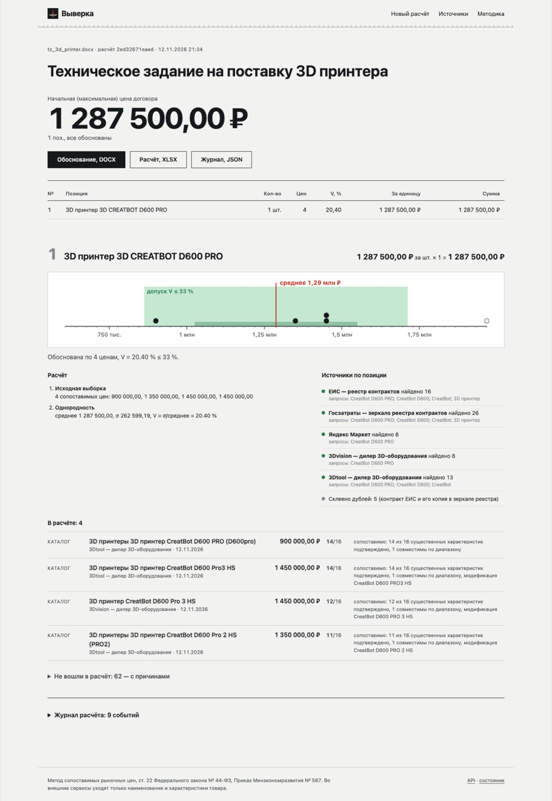

# Выверка

Обоснование начальной (максимальной) цены договора методом сопоставимых рыночных цен. Инициатор закупки загружает
техническое задание и получает расчёт НМЦД, в котором каждая цена ведёт к источнику: исполненному контракту ЕИС,
карточке товара или коммерческому предложению. Предложения, не прошедшие проверку, остаются в отчёте вместе
с причиной.

Решение кейса 2 хакатона «ИИ в системе управления МФТИ».

Стенд: https://vyverka.z1nex.ru — примеры из кейса открываются на главной, описание API — на `/api/docs`.



## Что получается на ТЗ кейса и на новой категории

| ТЗ | Результат | Почему так |
|---|---|---|
| Бумага SvetoCopy А4, 2500 пачек | 323,37 ₽ за пачку, 808 425 ₽; 7 цен, V = 5,75 % | контракты ЕИС с ценой за единицу и карточки маркетплейса |
| Бумага SvetoCopy А3, 25 пачек | 741,84 ₽ за пачку, 18 546 ₽; 10 цен | то же; пачки А4 отсеяны по формату |
| Бумага писчая офсетная А4, 65 г/м², 50 пачек | не обоснована: мало сопоставимых цен | у найденной офсетной бумаги 65 г/м² белизна 92–96 % против 142–148 % в ТЗ или не подтверждены характеристики; программа просит КП, а не придумывает цену |
| 3D-принтер CreatBot D600 Pro | 1 183 333,33 ₽; 3 цены трёх дилеров, V = 23,3 % | 16 характеристик сверены с карточками; другие модели и «только товарный знак» исключены с причиной |
| Цитокины IL-2, IL-7, IL-15, IL-21, TGF-β1 | не обоснованы, по каждой позиции своя причина | 1–2 цены или V = 47,52 % после очистки; добавление КП в интерфейсе достраивает расчёт |
| Мышь Logitech B100, 30 шт. (своё ТЗ, `examples/tz_mouse.docx`) | 594,54 ₽ за штуку, 17 836,20 ₽; 9 цен, V = 15,41 % | категории нет в настройках: сверка общими правилами, другие модели и повторы поставщиков исключены |

Числа воспроизводятся без сети: в образ входит набор сохранённых страниц `seed/snapshots`, по которым считались
эти примеры.

## Запуск

Нужен Docker с Compose v2. Внешних ключей и учётных записей нет.

```bash
docker compose up -d --build
```

Интерфейс откроется на http://localhost:8000, проверка состояния — http://localhost:8000/healthz.
Остановка:

```bash
docker compose down
```

Без Docker нужны Python 3.12 и [uv](https://docs.astral.sh/uv/):

```bash
uv sync
uv run vyverka serve --port 8000
```

### Командная строка

```bash
uv run vyverka run examples/tz_paper.docx --out reports --mode offline
```

Печатает цену по позициям и итог, складывает в папку reports обоснование DOCX, таблицу XLSX и журнал JSON.
Если НМЦД определена не по всем позициям, рядом кладётся запрос ценовой информации поставщикам.
Код возврата 0, если НМЦД определена по всем позициям, иначе 1.

```bash
uv run vyverka replay reports/nmck-<id>-<время>.json
```

Проверка воспроизводимости без сети. Журнал пересчитывается по правилам метода, действовавшим на момент
расчёта (они сохранены в журнале): каждая цена заново приводится к единице ТЗ, выборка собирается с учётом
решений закупщика, затем считаются среднее, V и НМЦД. Копии страниц сверяются с SHA-256 из журнала. Если
страницу потом загрузили заново, прежняя копия не перезаписывается, а уходит в папку versions рядом со снимками под своим
хешем, поэтому старые расчёты тоже проверяются. Подмена цены или копии в журнале даёт код возврата 1 и строку
с расхождением. То же в интерфейсе («Скачать» → «Проверка воспроизводимости») и в API: `GET /api/v1/runs/{id}/replay`.

```bash
uv run vyverka run tz.docx --policy open             # любые открытые источники с оценкой доверия
uv run vyverka batch /mnt/edo/incoming --out reports  # все ТЗ из папки
uv run vyverka sources list
uv run vyverka sources off ymarket --until 2026-12-01
uv run vyverka sources add "ООО Лабтех" --url "https://labtech.ru/search?q={q}" --trust 85
uv run vyverka sources import "Перечень источников.docx"
uv run vyverka settings set policy=open
```

### API

`/api/v1` — запуск расчёта файлом или текстом (с ожиданием результата или обратным вызовом), сводка, отчёты,
облако аналогов, добавление КП, решения закупщика, настройки и источники. Описание с примерами — `/api/docs`,
сценарии подключения к ЭДО, 1С и порталу закупок — [docs/integration.md](docs/integration.md).

### Режимы и переменные окружения

| Переменная | По умолчанию | Назначение |
|---|---|---|
| `VYVERKA_MODE` | `cache` | `live` — только сеть; `cache` — свежая сохранённая копия страницы (до 72 ч), иначе сеть, при отказе сети — любая сохранённая копия; `offline` — только сохранённые копии |
| `VYVERKA_DATA` | `./data`, в контейнере `/data` | расчёты (папка runs) и снимки страниц (папка snapshots) |
| `VYVERKA_CONFIG` | `./config` | источники, правила метода, словарь характеристик, профили организаций |
| `VYVERKA_PROFILE` | `mfti` | профиль организации из `config/profiles`: `mfti`, `vuz44`, `research` |
| `VYVERKA_LOCK_SETTINGS` | — | `1` — настройки только для чтения, меняет администратор через файл |
| `VYVERKA_API_KEYS` | — | ключи API через запятую; пусто — API открыт |
| `VYVERKA_WEBHOOK_HOSTS` | — | хосты, на которые разрешены обратные вызовы |
| `VYVERKA_BRAVE_API_KEY` | — | ключ Brave Search API для открытого поиска; без ключа выдача берётся со страницы поиска и может упираться в лимит частоты |
| `VYVERKA_SEARCH_CURL` | `1` | `0` — не вызывать системный curl для страницы поиска (так работают тесты) |
| `VYVERKA_PORT` | `8000` | порт на хосте в `compose.yaml` |
| `VYVERKA_USER_HEADER` | `X-Remote-User` | заголовок с логином от прокси единого входа |
| `VYVERKA_AI` | — | `1` — ИИ-версия: языковая модель дочитывает карточки (раздел «ИИ-версия») |
| `VYVERKA_LLM_URL` | `http://localhost:11434` | адрес модели: Ollama или совместимый с OpenAI сервер |
| `VYVERKA_LLM_API` | `ollama` | `openai` — для vLLM, YandexGPT, GigaChat через совместимый шлюз |
| `VYVERKA_LLM_MODEL` | `yandexgpt-lite:8b` | имя модели на сервере |
| `VYVERKA_LLM_KEY` | — | ключ для совместимого с OpenAI сервера |
| `VYVERKA_AI_MAX` | `12` | сколько карточек на позицию модель дочитывает (самые похожие на ТЗ) |

Режим можно выбрать и для одного расчёта: поле `mode` в форме или `--mode` в командной строке.

## Как считается

1. **Разбор ТЗ.** Таблица позиций из DOCX: наименование, единица, количество, ОКПД2, характеристики. Из характеристик
   получаются проверяемые признаки: число или диапазон с единицей, перечисление, марка и модель
   (`src/vyverka/tz/`).
2. **Запросы.** По каждой позиции строятся запросы: марка и модель, обобщённое наименование, ОКПД2
   (`planner.py`).
3. **Источники.** Каждый источник возвращает предложения со ссылкой, временем получения, ценой, единицей,
   характеристиками и ключом снимка страницы (`src/vyverka/sources/`). Дубли убираются по реестровому номеру контракта,
   по сочетанию поставщика, цены и даты, по адресу страницы.
4. **Сопоставимость.** Характеристики ТЗ сверяются с документом поставщика по значению, а не по названию:
   «не менее 420 °C» против «до 450 °C», «А3» против «А4», «10 мкг» против «50 мкг». Итог по каждому признаку —
   соответствует, совместимо, не соответствует или нет данных. Решение о включении и его причина записываются
   с машиночитаемым кодом (`other_model`, `spec_mismatch`, `unit_mismatch`, `same_supplier`, `outlier` и др.)
   (`match.py`). Расходники и запчасти («скобы для степлера», «ракель»), другой типоразмер (№10 вместо №24/6)
   и сборные строки контракта с чужими артикулами отсеиваются и в ТЗ, введённом словами.
   Поставщик каждой цены, которая идёт в расчёт, проверяется по ИНН в реестре недобросовестных поставщиков ЕИС
   (44-ФЗ и 223-ФЗ). Цена поставщика из РНП исключается с номером записи и датой включения, ответ реестра хранится
   копией страницы, а в DOCX и XLSX у каждой цены отмечено, проверен ли поставщик (`rnp.py`).
5. **Нормализация.** Цена приводится к единице ТЗ: пачка через число листов, мкг через фасовку, цены прошлых лет —
   произведением помесячных ИПЦ Росстата с месяца после заключения контракта по последний опубликованный месяц
   (ряд из `ipc_mes_09-2026.xlsx` лежит в `config/rules.yaml`; `normalize.py`, `units.py`). Если фасовка
   отличается от ТЗ больше чем вдвое, у цены появляется предупреждение: за мкг крупная фасовка обычно дешевле.
6. **Расчёт** по Приказу Минэкономразвития № 567: не меньше трёх цен, коэффициент вариации V = σ / x̄,
   где σ — выборочное отклонение (деление на n − 1). Цены автоматически не выбрасываются: методика при V > 33 %
   требует дополнительных исследований, поэтому Выверка показывает цену, сильнее всех отклоняющуюся от медианы,
   и каким станет V без неё, а исключает её закупщик вручную с комментарием, который попадает в отчёт.
   Автоматическое исключение (итеративное и фильтр MAD) включается в `config/rules.yaml` (`outlier: iterative`),
   если его разрешает положение заказчика. Если цен меньше трёх или совокупность неоднородна, позиция получает
   статус «не обоснована» и подсказку, что сделать (`calc.py`). Отдельный шаг «Проверка аномалий» отмечает цены
   с модифицированным z-баллом по MAD больше 3,5 (от пяти цен) и цены вдвое выше или ниже медианы; это подсказка,
   цены из расчёта не убираются.
7. **Отчёт.** Страница расчёта, обоснование DOCX для закупочной комиссии, XLSX, где среднее, σ, V и итог
   считаются формулами Excel из цен в той же строке, и журнал JSON со всеми
   запросами, ответами, фильтрами и шагами расчёта (`report.py`). У каждого предложения есть ссылка на
   сохранённую копию страницы той версии, которая попала в расчёт: в ней подсвечены цена и характеристики,
   подтверждённые при сопоставлении, а в шапке указаны адрес, время получения и SHA-256 (`web/highlight.py`).

Устройство подробнее, поток данных и сценарии — в [docs/architecture.md](docs/architecture.md).

## Источники

Задаются в `config/sources.yaml`. Новый каталог с HTML-выдачей подключается записью с селекторами, без кода.

| Источник | Уровень | Что берётся |
|---|---|---|
| ЕИС, реестр контрактов 44-ФЗ | 1 | исполненные контракты без неустоек за 3 года, цена за единицу из карточки |
| ЕИС, реестр договоров 223-ФЗ | 2 | исполненные договоры за 3 года: строка спецификации и предмет договора с маркой |
| Госзатраты (clearspending.ru) | 2 | зеркало реестра контрактов, когда ЕИС не отвечает |
| Яндекс Маркет | 3 | разметка schema.org на карточке товара |
| 3Dvision, 3Dtool, 3D Print Technologies | 3 | каталоги дилеров 3D-оборудования |
| Диаэм | 3 | каталог реактивов с фасовкой |
| Открытый поиск (Brave) | 4 | сайты магазинов и дилеров из выдачи: в строгом режиме только из списка организации |
| Коммерческие предложения | — | вводит пользователь на странице расчёта |

ЕАТ «Берёзка» описан в конфиге, но выключен: выдача строится скриптом в браузере, открытого API нет.

Режим источников переключается для организации и для отдельного расчёта:

- **только утверждённый список** — цены берутся из источников, перечисленных в списке организации, доверие 100 %;
  поиск по интернету ходит только на сайты из этого списка;
- **любые открытые источники** — добавляется поиск по интернету, у каждой цены считается доверие: вид источника
  (контракт 100, реестр 95, КП 90, каталог 85, маркетплейс 75, сайт из поиска 50) плюс признаки страницы — сайт
  из списка, цена в разметке schema.org, ИНН продавца, наличие, совпадение характеристик, давность контракта.
  Цена ниже порога (по умолчанию 60 %) в расчёт не идёт, но остаётся в отчёте с причиной.

На странице «Настройки», через API или консоль источник включается, выключается или отключается до даты, получает
своё доверие. Свой источник добавляется словами: адрес сайта поставщика или шаблон поиска с `{q}`. Утверждённый
список организации загружается файлом DOCX, XLSX или текстом: Выверка находит в нём сайты и виды источников и
отмечает подключённые.

## Похожие товары

Точного совпадения с ТЗ может не быть. Для каждой позиции строится облако найденных товаров: близость считается
по характеристикам ТЗ (числовые — с учётом допуска, текстовые — точно), по тексту (TF-IDF по триграммам), по ОКПД2
и по совпадению марки и модели. Товар другого вида, аксессуар или другой белок отодвигается к краю облака.
Кольца — идентичные (от 80 %), однородные (от 55 %), дальние аналоги.

По ближайшим соседям даётся справочная оценка цены: взвешенная по близости и доверию, а если цена явно зависит от
одной характеристики (объём камеры, масса) — по степенной регрессии. Оценка не подменяет расчёт по Приказу № 567:
если НМЦД обоснована, она показывает, насколько расчёт согласуется с рынком, если нет — служит ориентиром для
запроса КП. Ближайший аналог закупщик может принять в расчёт как однородный товар с комментарием; решение с
автором и временем попадает в отчёт и отменяется одной кнопкой.

Отказы: таймаут 20 с, два повтора, автомат-выключатель на хост (3 ошибки подряд — пауза 120 с), ограничение
одновременных запросов. Пустая выдача или изменившаяся вёрстка не роняет расчёт: источник получает статус,
который виден в отчёте, а расчёт идёт по остальным.

Порядок доступа к ЕИС требует доверия к сертификату Минцифры, поэтому в `certs/` лежат корневой и выпускающий
сертификаты Russian Trusted CA, они добавляются к системному набору.

## Настройка метода

Пороги методики, списки разрешённых и запрещённых сайтов и профиль организации меняются на странице «Настройки»
и хранятся в `data/settings.json` поверх конфигурации; настройки переносятся на другой стенд одним файлом.
Для другого вуза достаточно своего профиля в `config/profiles`: реквизиты, закон, сайты, пороги.

`config/rules.yaml`: минимальное число цен, предел V, срок давности контрактов, параметры отбраковки, правило
«одна цена от поставщика», индексы цен, допуски характеристик, правила категорий (например, для бумаги цветные
и линованные листы исключаются). `config/attributes.yaml` — словарь характеристик и их единиц.

## Данные и ИИ

Сторонним сервисам не передаются персональные данные: наружу уходят только поисковые запросы из наименования и
характеристик товара. Предложения индивидуальных предпринимателей в отчёте показываются без ФИО. Ядро
детерминированное и работает без языковой модели и без внутренних систем МФТИ.

## ИИ-версия

Отдельный запуск с языковой моделью: `VYVERKA_AI=1`, в контейнере —
`docker compose -f compose.yaml -f compose.ai.yaml up -d`. Базовая версия от неё не зависит и считает так же.

Что делает модель. Правила не всегда узнают характеристику в карточке: «146%(CIE)», «146ПРОЦ», «Точность по оси XY:
5.08 микрон». Для самых похожих на ТЗ карточек, где остались непроверенные существенные характеристики, модель
получает список этих характеристик и текст страницы и возвращает значение с цитатой (`src/vyverka/ai.py`).
Значение принимается, только если цитата дословно есть в копии страницы и содержит числа значения; дальше его
сравнивает с ТЗ тот же код, что и без модели. Модель может только подтвердить характеристику. Если её значение
противоречит ТЗ, цена не исключается, а в таблице проверок появляется пометка «ИИ?» для закупщика: модель могла
прочитать соседнее свойство. В DOCX и XLSX у каждого такого значения стоит цитата.

Модель локальная — Ollama, по умолчанию YandexGPT 5 Lite 8B. Текст закупки не уходит за контур организации, что
снимает вопрос о передаче данных внешнему сервису. Через `VYVERKA_LLM_API=openai` подключается любой совместимый
сервер: vLLM, YandexGPT или GigaChat через шлюз. Ответы модели кешируются; для трёх ТЗ кейса кеш лежит в
`seed/ai_cache`, поэтому ИИ-версия воспроизводит расчёт без модели.

Замер на трёх ТЗ кейса, YandexGPT 5 Lite 8B на MacBook с 16 ГБ памяти:

| | Бумага | 3D-принтер | Цитокины |
|---|---|---|---|
| Карточек дочитано | 34 | 5 | 22 |
| Характеристик подтверждено с цитатой | 6 | 3 | 0 |
| Пометок «ИИ?» для закупщика | 12 | 4 | 0 |
| Отклонено: цитаты нет на странице | 1 | 4 | 0 |
| Изменилось решений и НМЦД | 0 | 0 | 0 |
| Время первого прогона | 4 мин | 1 мин | 20 с |

Вывод честный: на этих трёх ТЗ модель не меняет НМЦД. Расчёт упирается не в чтение, а в то, что данных нет в
источниках: у контрактов на цитокины в тексте не указана фасовка, и модель её не придумает. Модель добавляет
подтверждённые цитатой характеристики и находит расхождения, которые правила пропускают (офсетная бумага
80 г/м² при требовании 65 г/м², один экструдер при требовании двух), но примерно половина пометок «ИИ?» —
шум («Вид бумаги: А4»), поэтому они только подсказывают. Проверка цитатой отсекла пять находок, для которых на странице нет такой цитаты.
ИИ-версия полезнее там, где карточки написаны свободным текстом без таблицы характеристик.

## Тесты

```bash
uv run pytest
```

84 теста: расчёт на эталонных числах, разбор трёх ТЗ кейса, нового ТЗ и свободного описания, сопоставление характеристик, моделей и типоразмеров,
дедупликация, разбор реестров 223-ФЗ и РНП, отказ источников и сломанная разметка, воспроизведение расчёта по журналу, сквозной прогон веб-интерфейса.

## Зависимости

| Пакет | Версия | Лицензия |
|---|---|---|
| FastAPI | 0.162.5 | MIT |
| Starlette | 1.10.0 | BSD-3-Clause |
| Uvicorn | 0.54.0 | BSD-3-Clause |
| uvloop, httptools, websockets, watchfiles (через `uvicorn[standard]`) | — | MIT / Apache-2.0, MIT, BSD-3-Clause, MIT |
| HTTPX | 0.28.1 | BSD-3-Clause |
| certifi | 2026.10.23 | MPL-2.0 |
| Pydantic | 2.14.3 | MIT |
| Jinja2 | 3.1.6 | BSD-3-Clause |
| python-docx | 1.2.0 | MIT |
| openpyxl | 3.1.5 | MIT |
| python-multipart | 0.0.33 | Apache-2.0 |
| PyYAML | 6.0.3 | MIT |
| selectolax | 1.0.2 | MIT |
| lxml | 6.1.3 | BSD-3-Clause |
| pytest (разработка) | 9.2.0 | MIT |
| respx (разработка) | 0.23.1 | BSD-3-Clause |

Точные версии всех пакетов, включая транзитивные, — в `uv.lock`. Интерфейс без сборщика и без внешних скриптов.

## Ограничения

План внедрения по этапам, ресурсы и стоимость, оставшиеся ограничения — в
[docs/integration.md](docs/integration.md#план-внедрения-в-мфти). Коротко:

- Цены маркетплейсов — это оферты, а не исполненные сделки; в расчёте они идут после контрактов ЕИС.
- ТЗ в PDF и сканы не читаются: нужен DOCX или текст.
- Пересчёт фасовки реактивов линейный; если положение о закупке МФТИ это запрещает, правило выключается в
  `config/rules.yaml`.

## Автор

Илья Григорьев, ноябрь 2026. Сделано за время хакатона «ИИ в системе управления МФТИ»: разбор ТЗ, поиск и сверка
цен, расчёт, отчёты, веб-интерфейс, API и ИИ-версия. Лицензия MIT.
