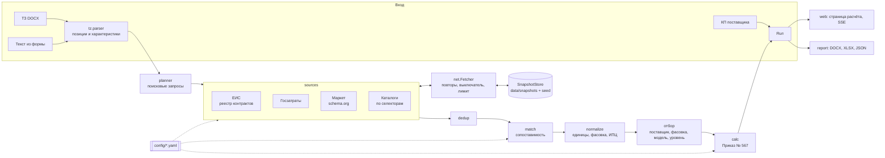

# Устройство

Одно приложение на Python 3.12: веб-интерфейс FastAPI с серверными шаблонами и командная строка поверх одного и того
же конвейера. Базы данных нет: расчёт хранится одним JSON-файлом, снимок страницы — файлом с метаданными и SHA-256.
Так расчёт можно перенести, приложить к закупке и переиграть без сети.

## Компоненты

| Модуль | Отвечает за |
|---|---|
| `tz/parser.py`, `tz/attrs.py` | таблица позиций из DOCX или текста; характеристика превращается в признак: интервал с единицей, набор значений, марка и модель |
| `planner.py` | запросы от точного к общему: марка и модель, наименование без характеристик, ОКПД2 |
| `sources/eis.py` | поиск по реестру контрактов 44-ФЗ и 223-ФЗ, карточка контракта, цена за единицу из спецификации |
| `sources/clearspending.py` | API зеркала реестра |
| `sources/jsonld.py`, `sources/html.py` | карточки по разметке schema.org и каталоги по CSS-селекторам из конфига |
| `net.py` | HTTP-клиент: таймаут, повторы, автомат-выключатель на хост, ограничение параллельности, снимки страниц |
| `match.py` | признаки ТЗ против текста предложения; марка и модель; итог с кодом причины |
| `normalize.py`, `units.py` | пересчёт в единицу ТЗ, фасовка, индексация цен прошлых лет |
| `pipeline.py` | порядок шагов, правила отбора, журнал событий |
| `calc.py` | статистика и итерационная отбраковка; статус вместо цены, если данных мало |
| `report.py` | документ для комиссии, книга Excel с формулами, журнал |
| `replay.py` | пересчёт журнала без сети по правилам на момент расчёта, сверка копий страниц по SHA-256 |
| `web/` | загрузка ТЗ, ход расчёта в реальном времени, страница результата, ввод КП, копии страниц с подсветкой цены и характеристик (`highlight.py`) |

## Поток одного расчёта

1. `parse` — ТЗ разобрано, у каждой позиции категория (`paper`, `reagents`, `generic`) из `config/rules.yaml`.
2. `plan` — запросы по позиции.
3. `source` — источники опрашиваются параллельно. Каждый ответ сохраняется снимком; предложение ссылается на ключ
   снимка, и на странице расчёта можно открыть ту копию страницы, по которой взята цена.
4. `dedup` — одна и та же сделка из ЕИС и из зеркала остаётся один раз.
5. `match` — по каждому существенному признаку статус «соответствует / совместимо / не соответствует / нет данных»;
   включение по доле подтверждённых признаков (`include_score`), противоречие по существенному признаку исключает.
6. Отбор:
   - один поставщик — одна цена, берётся более свежий контракт;
   - фасовки одного товара в каталоге — одна цена, ближайшая к ТЗ;
   - если в ТЗ названа модель и цен по ней хватает, другие модели уходят в резерв;
   - источники по старшинству: контракты ЕИС, зеркало, оферты; следующий уровень подключается при нехватке цен.
7. `calc` — расчёт; каждый шаг (выборка, V, подсказка о крайней цене и V без неё) записан текстом.
8. `done` — итог, отчёты доступны для скачивания.

Каждый шаг пишет событие в журнал. Веб-страница получает события через Server-Sent Events, журнал целиком уходит
в JSON-отчёт.

## Воспроизводимость

В журнал расчёта, кроме решений и шагов, записываются правила метода целиком (`settings.rules`). Копия страницы
хранится под ключом адреса; при повторной загрузке прежняя копия переносится в `snapshots/versions/` под своим
хешем, поэтому каждое предложение ссылается на ту версию страницы, по которой взята цена.

`vyverka replay` (и `GET /api/v1/runs/{id}/replay`) по журналу:

1. подставляет правила на момент расчёта;
2. для каждого предложения с ценой находит копию страницы по SHA-256 и сверяет хеш тела;
3. заново приводит цену к единице ТЗ на дату расчёта (`normalize.py`; КП берётся как введено);
4. собирает выборку: прошедшие сопоставление и решения закупщика, без отсева на этапе расчёта;
5. считает НМЦД (`calc.py`) и сравнивает с журналом по позициям: статус, n, V, цена за единицу, сумма.

Изменённая в журнале цена, подменённая копия или другие правила дают расхождение с указанием строки.

## Отказы

| Ситуация | Поведение |
|---|---|
| Таймаут или 5xx | два повтора с паузой, затем снимок из хранилища, если есть |
| Три ошибки подряд на хосте | хост пропускается 120 с, остальные источники работают |
| Пустая выдача или новая вёрстка | источник помечен «пусто» с пояснением, расчёт продолжается |
| Все источники недоступны | позиции получают статус «мало сопоставимых цен», расчёт не падает |
| Нет сети совсем | режим `offline`: расчёт по сохранённым снимкам |

Всё это покрыто тестами в `tests/test_sources.py`.

## Сценарии

### 1. Типовая закупка по ТЗ с таблицей

Вход: `examples/tz_paper.docx`, три позиции бумаги.
Выход: по А4 — 7 цен из контрактов ЕИС и маркетплейса, V = 5,75 %, 323,37 ₽ за пачку, 808 425 ₽ за 2500 пачек;
по А3 — 10 цен, 18 546 ₽; пачки А4 в выдаче по А3 исключены с причиной «формат А4, в ТЗ А3». Офсетная бумага
А4 65 г/м² (белизна 142–148 %) — статус «не обоснована: мало сопоставимых цен» и подсказка запросить КП. Итог НМЦД не выводится, пока
не обоснованы все позиции.

### 2. Оборудование с названной моделью и техническими требованиями

Вход: `examples/tz_3d_printer.docx`, CreatBot D600 Pro и 16 характеристик.
Выход: 3 цены трёх разных дилеров (3Dtool, 3D Print Technologies, 3Dvision), V = 23,3 %, 1 183 333,33 ₽.
От одного поставщика берётся одна цена: три карточки 3Dtool на разные модификации считались бы одним источником. Предложения на другие
модели и карточки, где назван только товарный знак, исключены с причиной; у каждой цены видна матрица
«требование ТЗ — значение у поставщика».

### 3. Реактивы, цены за мкг и коммерческие предложения

Вход: `examples/tz_cytokines.docx`, пять рекомбинантных белков с фасовкой «не менее N мкг».
Выход: позиции, где сопоставимых цен меньше трёх, получают статус «мало сопоставимых цен»; у IL-15 после очистки
V = 47,49 % — «цены неоднородны». Пользователь добавляет КП поставщика на странице расчёта (поставщик, цена,
номер письма) — позиция пересчитывается. Пример: КП на 26 000 ₽ к IL-7 даёт 3 цены, V = 24,59 %, 26 692,09 ₽.

### 4. Свободное описание без ТЗ

Вход: строка в поле на главной: наименование с моделью, характеристики через запятую, количество после тире.
Позиция получает категорию `generic`; если модель содержит цифры, она сверяется строго, артикул в скобках
считается тем же именем модели. Проверено на двух категориях, которых нет в ТЗ кейса:

- «Картридж HP 59A (CF259A), черный, ресурс 3000 страниц — 10 шт.» Заправка и ремонт картриджей исключены
  как услуги, картриджи 05A, 83A, 59X — как другие модели, совместимый картридж ушёл в эквиваленты. В расчёте
  контракты на оригинальный 59A; одна цена 1 665 ₽ оставляет V = 46 %, итог — «цены неоднородны» с предложением
  запросить КП.
- «Монитор Dell P2423, 24 дюйма, 1920x1200, IPS — 5 шт.» Выдача возвращает P2423D и P2423DE с разрешением
  2560x1440; оба исключены как другие модели с несовпадающим разрешением, итог — «мало сопоставимых цен».
  Цена соседней модели в обоснование не подставляется.

### 5. Новая категория документом ТЗ, без доработки кода

Вход: `examples/tz_mouse.docx` — ТЗ в той же форме, что у принтера: мышь Logitech B100, 30 шт., ОКПД2
26.20.16.170, восемь характеристик. Для мышей в программе нет ни правил, ни словарей: позиция получает категорию
`generic`, характеристики сверяются общими правилами. Выход: 9 контрактов ЕИС на B100, V = 15,41 %,
594,54 ₽ за штуку, 17 836,20 ₽. Мыши M171 и другие модели исключены по модели, повторные цены одного поставщика —
по правилу «один поставщик — одна цена», старые контракты 2024 года остались в резерве. Длина кабеля в КТРУ
записана диапазоном в метрах («≥ 1,5 и < 2 Метр») и приводится к миллиметрам ТЗ.
